# Notenpult

Noten-App für Windows 11 und Android-Tablets für Blaskapelle und Brassband: Setlists mit Ordner-Nummern, A–Z-Bibliothek,
Blättern mit einem Tipp, mehrere Stimmen pro Stück, Stift-Anmerkungen in Rot und Schwarz,
A4/A5-Unterstützung, Dunkelmodus und ein Noten-Pool aus Google Drive, der auch offline funktioniert.

## Entstehung

Notenpult ist ein privates Projekt für meine Band. Ich habe die App mit einem KI-Assistenten (Claude Code) entwickelt: Anforderungen, Tests auf den Geräten und Releases kommen von mir, den Großteil des Codes hat der Assistent geschrieben.

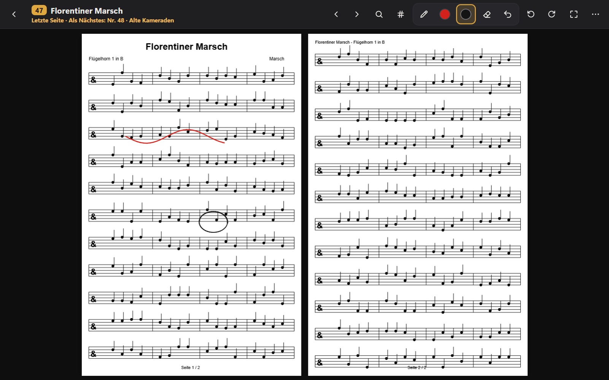

## Funktionen

- **Setlists**: beliebig viele, eigene Reihenfolge per Ziehen, Nummern aus dem Notenordner (z. B. 1–120 bei
  60 Stücken), Anzeige in Zehnerblöcken, „Nach Nummer sortieren“, „Nummern fortlaufend vergeben“.
- **A–Z-Bibliothek**: alphabetisch gruppiert, Buchstabenleiste zum Springen, Suche. Mehrfachauswahl über das
  Symbol vorne an jedem Stück – z. B. 100 Stücke auswählen und mit einem Tipp löschen oder in eine Setlist legen.
- **Genres**: eigene Hashtags wie `#Marsch`, `#Polka`, `#Kirche` – mehrere pro Stück, als Filter-Chips in der
  Bibliothek und beim Zusammenstellen von Setlists; `#polka` in jeder Suche.
- **Blättern**: Tippen oder Klicken irgendwo auf der Seite blättert weiter, am Stückende direkt ins nächste
  Stück. Zurück per Wischen nach rechts oder unten, Rechtsklick, ◀ oder Pfeiltaste. Auf Wunsch **halbe Seiten**:
  oben schon die nächste Seite, unten noch die aktuelle ([mehr](#halbe-seite-umblättern)).
- **Sprung-Links** für Wiederholungen, D.S. und Coda: antippen (oder Pedal) springt zur Zielstelle, ein Knopf
  bringt dich zurück ([mehr](#sprung-links-wiederholungen-ds-coda)).
- **Blättern per Gesicht**: Kopf drehen, Mund öffnen oder zwinkern – die Kamera vorne erkennt es, alles bleibt auf
  dem Gerät ([mehr](#blättern-per-gesicht)).
- **Stimmgerät** mit einstellbarem Kammerton (z. B. 442 Hz, wird gespeichert) und Anzeige für B-, Es- und
  F-Instrumente – auch klein **auf dem Blatt**: nur „+12¢“ in Rot, verschieb- und vergrößerbar
  ([mehr](#stimmgerät)).
- **Fußpedal & Fernbedienung**: Bluetooth-Pedale (AirTurn, PageFlip, M-Vave/Cuvave, Donner …), Selfie-Auslöser,
  Scroll-Ringe („TikTok-Ringe“), Mausrad und MIDI-Pedale blättern – unter Windows und Android. Jede Taste lässt
  sich zuweisen, auch „Nächstes Stück“ oder „Nächste Stimme“ ([mehr](#fußpedal--fernbedienung)).
- **Nummer eingeben**: Im Notenmodus einfach die Nummer tippen, schon springt die App zum Stück.
- **Stimmen**: beliebig viele PDFs pro Stück (1., 2., 3. Stimme …), oben per Knopf umschaltbar.
  `Stück - 2. Stimme.pdf` wird beim Import automatisch verknüpft.
- **Stift**: Der Stift schreibt sofort, Finger und Trackpad blättern. Radieren mit dem Radierer-Ende oder der
  Stifttaste. Handballen-Erkennung, Rückgängig. Anmerkungen gelten je Stimme und Seite. Dazu Blau, Grün,
  Textmarker, Text und **Stempel** (pp … ff, fp, sfz, Crescendo, Decrescendo, Akzent, Atemzeichen, Fermate, Brille,
  Coda, Kreis) – [mehr](#stempel-text-und-textmarker).
- **A4 / A5**: Die Ansicht „Automatisch“ füllt den Bildschirm: A4 im Querformat zwei Seiten nebeneinander,
  A5-Querformat im Hochformat zwei Seiten untereinander. Weiße Ränder werden automatisch abgeschnitten.
- **Zwei-Seiten-Ansicht**: „Zwei Seiten“ zeigt immer zwei Seiten zusammen; „Erste einzeln“ zeigt die erste Seite
  allein und danach je zwei; „Nur 2-seitige“ zeigt Stücke mit genau zwei Seiten komplett auf einem Bildschirm (ohne
  Umblättern), alle anderen einseitig. Je für Quer- und Hochformat.
- **Ansicht je Stück und Stimme**: Im Notenmodus über ⋯ gewählt, merkt sich Notenpult die Ansicht für genau dieses
  Stück und diese Stimme – beim nächsten Öffnen ist sie wieder da. Per Schalter abschaltbar, z. B. auf einem kleinen
  Tablet, das immer nur eine Seite zeigen soll ([mehr](#ansicht-je-stück-und-stimme)).
- **Drehen**: ⟲ ⟳ dreht Seiten um 90°, die Drehung wird gespeichert.
- **Google Drive / Noten-Pool**: Ein Drive-Ordner wird zum Pool, auf Wunsch gefiltert auf die eigene Stimme.
  Noten werden kopiert und sind offline verfügbar; Änderungen kommen bei Verbindung automatisch.
- **Suche**: über Titel, Stimmen, Setlist-Nummern und den Noten-Pool. Während des Spielens wird ein
  gefundenes Stück eingeschoben (z. B. für Zugaben).
- **Darstellung**: Hell/Dunkel, Noten optional invertiert, Hoch- und Querformat, Vollbild, Bildschirm bleibt an.
  Oberfläche „Notenpult 2“ in Graphit mit **poliertem Messing** wie lackiertes Instrumentenblech (Knöpfe, Schalter
  und Markierungen mit Glanzkante; Standard) oder „Klassisch“ wie bis Version 1.6. Die **Akzentfarbe** ist frei wählbar (*Einstellungen → Darstellung*: Schnellfarben Messing, Silber,
  Kupfer, Blau, Grün, Bordeaux, Farbfeld oder Hex-Wert wie `#2f6fd0`) – Notenpult passt Schrift auf Knöpfen und
  Textfarbe so an, dass alles lesbar bleibt; „Standard“ geht zurück zu Messing.
- **Im WLAN teilen**: Ein Gerät zeigt einen 4-stelligen Code, ein anderes im selben WLAN (oder Handy-Hotspot)
  holt sich damit die Noten – verschlüsselt, ohne ZIP-Datei, nur fehlende Dateien. Windows und Android in jeder
  Richtung.

| Setlist mit Nummern | Stimmen umschalten | A5 im Hochformat |
| --- | --- | --- |
| 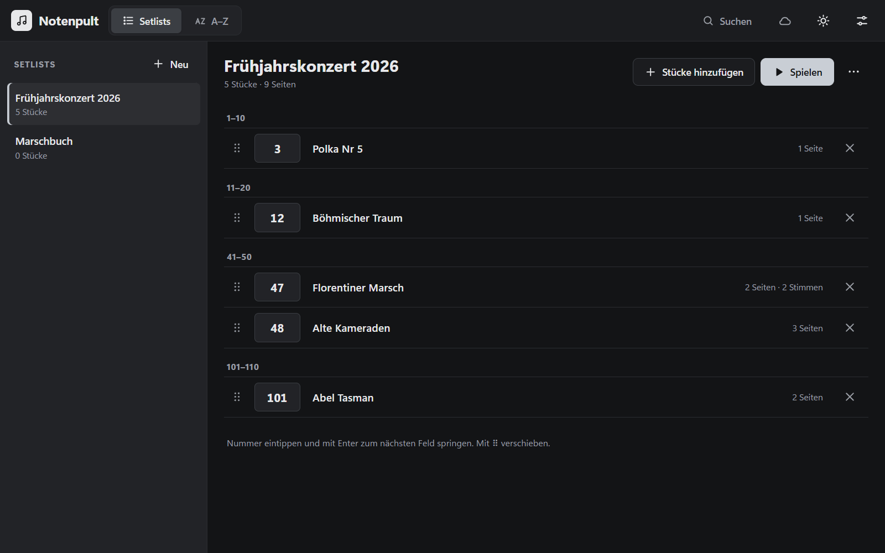 | 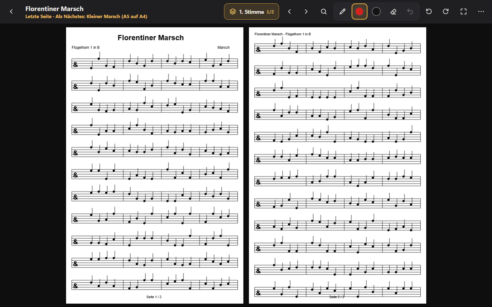 | 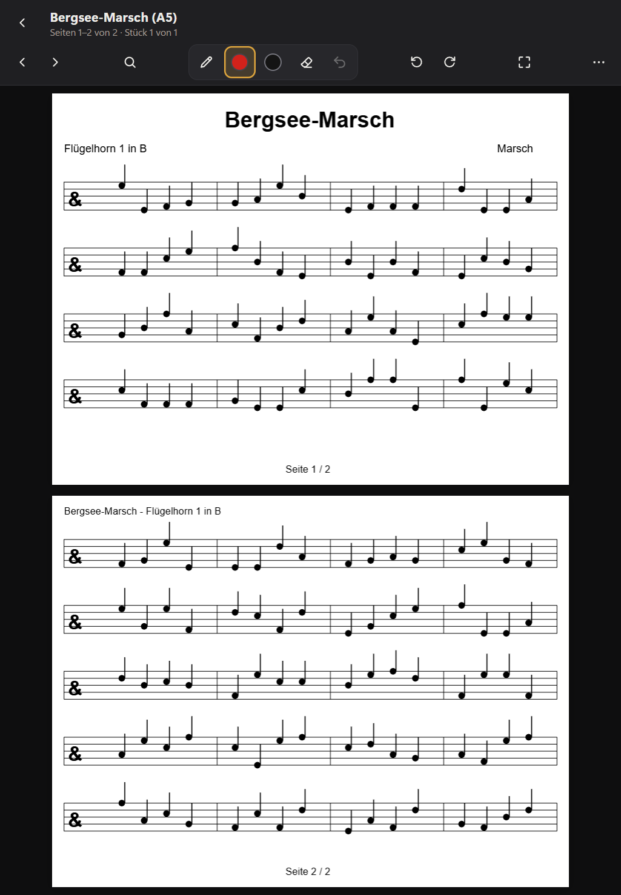 |

| Nummernblock | Suche im Noten-Pool | Stück bearbeiten |
| --- | --- | --- |
| 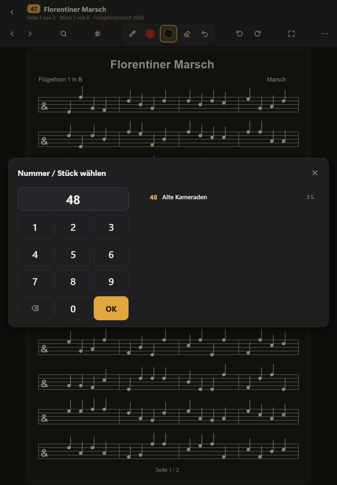 | 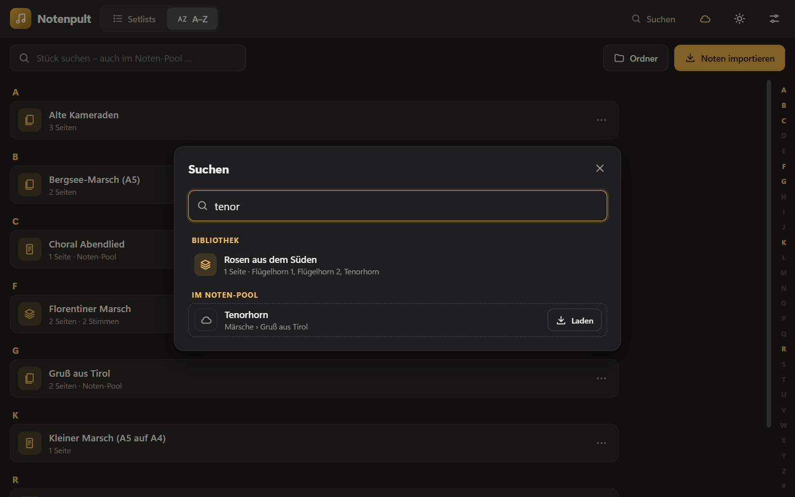 | 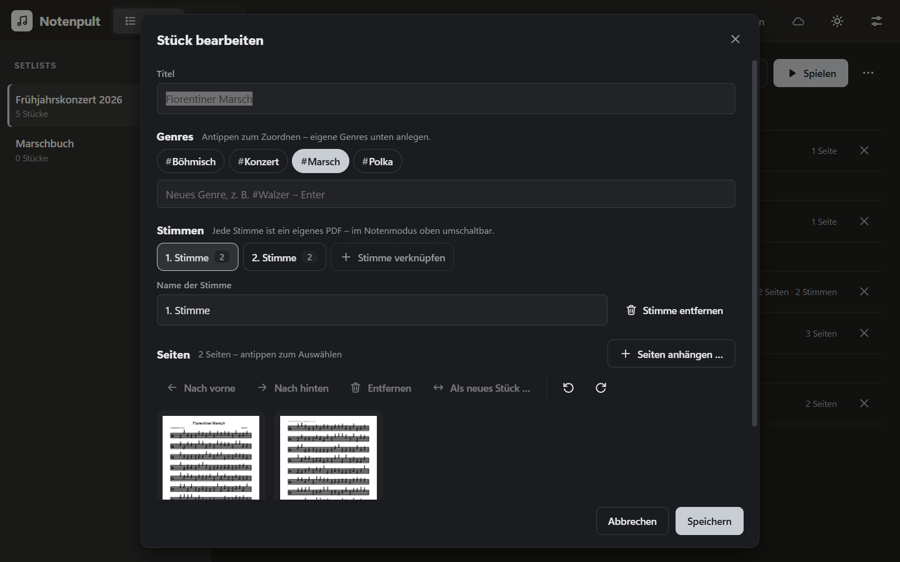 |

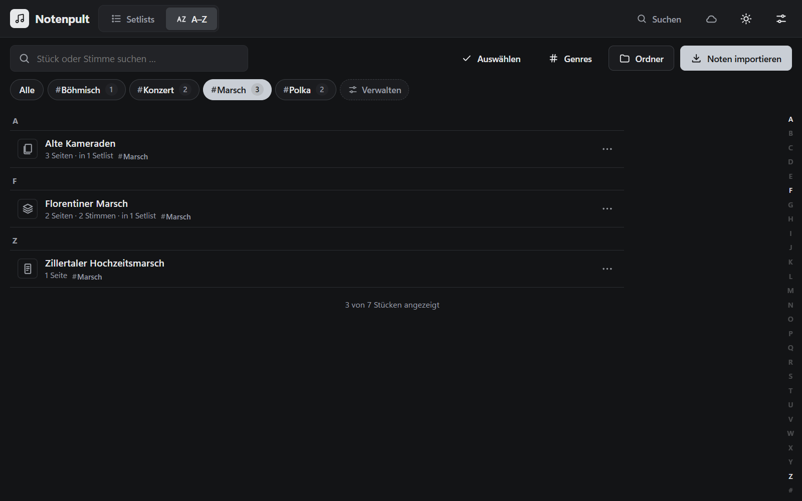

## Mehrere Stücke auf einmal (A–Z)

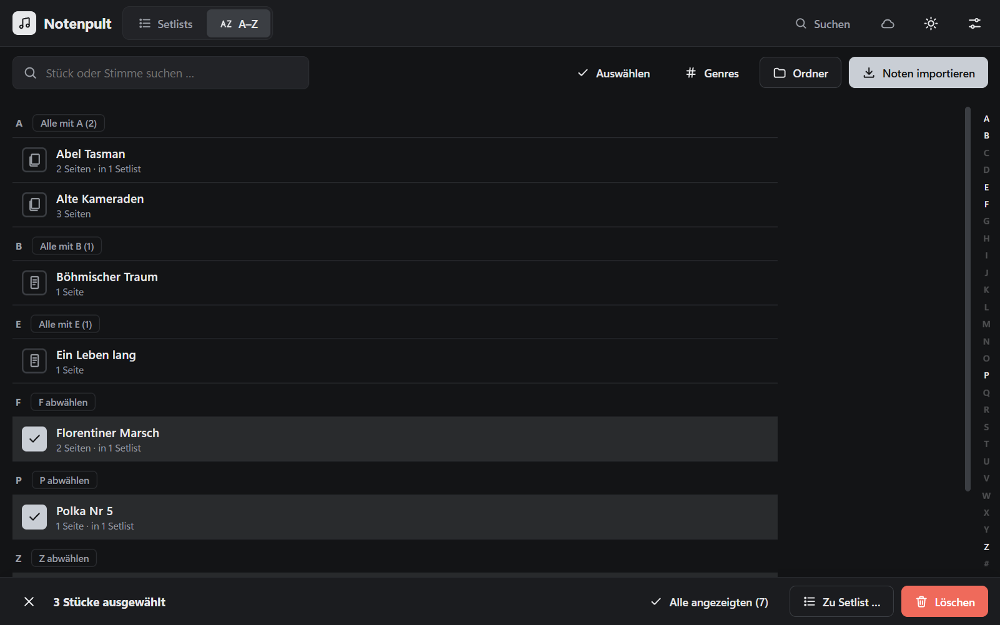

- **Starten**: vorne auf das Symbol eines Stücks tippen (oder oben „Auswählen“). Jetzt wählt jeder Tipp auf eine
  Zeile aus bzw. ab – geöffnet wird nichts.
- **Viele auf einmal**: Umschalt+Klick wählt alles zwischen zwei Stücken, „Alle mit A“ neben dem Buchstaben eine
  ganze Gruppe, „Alle angezeigten“ in der Leiste alles, was Suche und Genre-Chips gerade zeigen
  (z. B. `#polka` suchen → alle Polkas).
- **Aktionen** in der Leiste unten: „Zu Setlist …“ oder „Löschen“. Vor dem Löschen fragt Notenpult nach und nennt
  Anzahl, Titel und betroffene Setlists. Mit den Stücken gehen ihre Setlist-Einträge und Anmerkungen; der Noten-Pool
  lädt gelöschte Stücke nicht erneut.
- **Beenden**: ✕ in der Leiste, Esc, Zurück-Taste (Android) oder Wechsel zu den Setlists.

## Genres

- **Anlegen**: A–Z → „Genres“ (oder „Verwalten“ in der Chip-Leiste). Eigene Namen, `#` davor ist egal;
  Vorschläge wie Marsch, Polka, Walzer lassen sich antippen.
- **Zuordnen**: im Menü eines Stücks „Genres …“, im Stück-Editor, oder unter „Genres“ → „Stücke zuordnen“ alle
  passenden Stücke auf einmal anhaken.
- **Suchen**: Chips über der A–Z-Liste antippen (mehrere = „oder“), `#polka` ins Suchfeld tippen, oder in der
  globalen Suche (Strg+F) auf ein Genre tippen. Beim Zusammenstellen einer Setlist filtern die Chips ebenfalls –
  „Alle angezeigten wählen“ nimmt z. B. alle Märsche auf einmal.
- **Umbenennen** auf einen vorhandenen Namen führt beide Genres zusammen; Löschen entfernt nur das Genre,
  nicht die Stücke.

## Installation & Updates

Fertige Builds gibt es unter **Releases** (`Notenpult-win32-x64.zip`): entpacken und `Notenpult.exe`
starten. Selbst bauen: siehe [Entwicklung](#entwicklung).

**Updates** kommen danach direkt in der App: *Einstellungen → Updates → „Nach Updates suchen“*, dann
*„Jetzt aktualisieren“*. Notenpult lädt die neue Version, prüft sie (SHA-256), tauscht die Programmdateien und
startet neu. Meist wird nur der App-Teil geladen (wenige MB), das komplette Paket nur bei einer neuen
Electron-Laufzeit. Noten, Setlists, Stimmen und Anmerkungen in `Dokumente\Notenpult` bleiben unberührt.
Auf Wunsch sucht die App beim Start selbst und zeigt einen roten Punkt am Einstellungen-Knopf.
Nach dem Neustart bestätigt Notenpult die neue Version – oder sagt, warum das Update nicht eingespielt wurde.

Liegt Notenpult in einem geschützten Ordner (z. B. `C:\Programme`), fragt Windows beim Aktualisieren nach
Administratorrechten – dort „Ja“ wählen. Ohne diese Abfrage geht es, wenn der Ordner dem eigenen Benutzer gehört.

**Empfohlener Ort:** `%LOCALAPPDATA%\Programs\Notenpult` (in die Adresszeile des Explorers eingeben). Nicht in
„Dokumente“, auf dem Desktop oder in OneDrive: Dort synchronisiert OneDrive unnötig ~250 MB Programmdateien, und der
Ransomware-Schutz von Windows kann Updates blockieren. Umziehen: Notenpult schließen, den ganzen Ordner
verschieben, Verknüpfung neu anlegen – die Noten in `Dokumente\Notenpult` bleiben, wo sie sind.

## Android-Tablet

Die Android-App hat dieselbe Oberfläche und läuft ab **Android 5.0** – gedacht z. B. für das Galaxy Tab S2.

**Installieren**

1. Auf dem Tablet unter *Einstellungen → Sicherheit* (bzw. *Gerätesicherheit*) **„Unbekannte Quellen“** erlauben.
2. Im Browser des Tablets die neueste Version unter
   [Releases](https://github.com/MaxKuhnDE/notenpult/releases/latest) öffnen und `Notenpult-android.apk`
   laden – oder die Datei am PC laden und per USB in den Ordner „Download“ kopieren.
3. Die Datei antippen → **Installieren**.
4. Zeigt Notenpult „Android System WebView ist zu alt“: im Play Store *Android System WebView* aktualisieren
   (unter Android 5 gibt es dort Version 95, gebraucht wird mindestens 92).

Zeigt der Browser des Tablets GitHub als **„unsichere Seite“**, liegt das an Android 5: Es kennt die heutigen
Stammzertifikate von GitHub nicht. Dann die APK am PC laden und per USB kopieren. Notenpult selbst bringt ab
1.3.1 aktuelle Zertifikate mit – die Update-Suche in der App funktioniert also trotzdem.

**Alles vom PC übernehmen**

Am einfachsten über [Im WLAN teilen](#im-wlan-teilen-ohne-zip): am PC „Teilen …“, am Tablet „Aus dem WLAN
holen“ und den Code eingeben. Ohne gemeinsames WLAN geht es mit der ZIP-Datei:

1. Am PC: *Einstellungen → Daten → „Exportieren …“* – speichert z. B. `Notenpult-Export-2026-10-02.zip`.
2. Tablet per USB anschließen und die ZIP in den Ordner **„Download“** kopieren.
3. Auf dem Tablet: *„Export vom PC importieren“* (bzw. *Einstellungen → Daten → „Importieren …“*) und die ZIP
   wählen. Danach sind Stücke, Stimmen, Setlists mit Nummern, Genres, Anmerkungen und Einstellungen
   **spiegelgleich** zum PC – nur die Seitenansicht des Tablets bleibt, wie sie ist.

Später geht es jederzeit wieder so – auch umgekehrt (Tablet exportieren, am PC importieren), z. B. um
Anmerkungen vom Tablet zurückzuholen. Der Import ersetzt immer alles auf dem Zielgerät.

**Bedienung**: Tippen blättert wie am PC. Das Galaxy Tab S2 hat keinen Stift – zum Schreiben oben den
**Zeichenmodus** (Stift-Symbol) einschalten, dann schreibt der Finger; Radierer und Rückgängig wie gewohnt.
Die Zurück-Taste schließt Dialoge und die Notenansicht. Updates: *Einstellungen → Updates → „Jetzt
aktualisieren“* lädt die neue APK und öffnet die Installation – dort „Installieren“ tippen, die Daten bleiben
erhalten.
Google Drive (Noten-Pool) gibt es nur unter Windows; die Noten kommen über „Im WLAN teilen“ oder den Export
aufs Tablet.

## Im WLAN teilen (ohne ZIP)

Ein Gerät **teilt**, ein anderes **holt** – vom Laptop aufs Tablet, vom Tablet auf den Laptop oder das Tablet
eines Freundes, zwischen zwei Tablets. Es geht immer nur in eine Richtung: Das teilende Gerät wird nie
verändert. Und es ist nur eine Sitzung – nichts bleibt gekoppelt.

1. Auf dem Gerät mit den Noten: *Einstellungen → Daten → „Im WLAN teilen“*. Es zeigt einen **4-stelligen Code**.
2. Auf dem anderen Gerät: *Einstellungen → Daten → „Aus dem WLAN holen“* (bei leerer Bibliothek auch direkt auf
   der Startseite). Das teilende Gerät erscheint in der Liste – antippen und den Code eingeben.
3. Notenpult zeigt, was kommt und wie viel zu laden ist. Dann wählen:
   - **Alles übernehmen (spiegelgleich)** – danach ist das Gerät wie das teilende (wie beim ZIP-Import).
   - **Zu meinen Noten hinzufügen** – eigene Stücke und Einstellungen bleiben; Stücke, die es auf beiden Geräten
     gibt, kommen im Stand des teilenden Geräts.
4. Übertragen werden nur Notendateien, die noch fehlen – beim zweiten Mal geht es meist in Sekunden.

Gut zu wissen:

- **Beide Geräte im selben WLAN.** Ein **Handy-Hotspot** geht auch: Laptop und Tablet ins WLAN des Handys –
  die Daten gehen über das Handy direkt von Gerät zu Gerät, nicht ins Internet (kein Datenvolumen).
- Der Code gilt für **ein** Gerät und **eine** Übertragung, danach zeigt Notenpult einen neuen. Nach drei
  falschen Eingaben gibt es ebenfalls einen neuen Code.
- **Verschlüsselt**: Aus dem Code handeln beide Geräte einen Schlüssel aus (SPAKE2 – Diffie-Hellman mit
  Passwort), alles danach läuft mit AES-256-GCM. Wer im WLAN mithört, sieht weder Noten noch Code und kann den
  Code auch nicht nachträglich durch Ausprobieren herausfinden.
- **Windows-Firewall**: Beim ersten Teilen fragt Windows, ob Notenpult im Netzwerk erreichbar sein darf –
  erlauben. Im Handy-Hotspot gilt das Netz meist als „Öffentlich“: dort den Haken bei *Öffentliche Netzwerke*
  setzen. Zum Holen braucht es keine Freigabe.
- Erscheint das Gerät nicht in der Liste (manche Router und Gäste-WLANs blockieren die Suche), die
  **Adresse** eingeben, die beim teilenden Gerät unter dem Code steht.
- Den vorherigen Stand legt Notenpult vorher beiseite (unter Windows im Datenordner `_vor-abgleich`).
- Die **Seitenansicht** (Quer-/Hochformat und „Ansicht je Stück und Stimme merken“) gehört zum Bildschirm und
  bleibt auch bei „Alles übernehmen“ so, wie sie auf diesem Gerät eingestellt ist.

## Bedienung im Notenmodus

| Aktion | Wirkung |
| --- | --- |
| Tippen / Klicken irgendwo (Finger, Trackpad, Maus) | nächste Seite, am Stückende nächstes Stück |
| Nach rechts oder unten wischen, Rechtsklick, ←, Bild ↑ | zurück |
| Nach oben wischen, Mausrad, →, Bild ↓, Leertaste | weiter |
| Fußpedal, Selfie-Auslöser, Scroll-Ring, MIDI-Pedal | wie zugewiesen (Standard: weiter/zurück, siehe unten) |
| Stift | schreibt sofort (Farbe oben wählen) |
| Radierer-Ende oder Stifttaste | löscht ganze Striche |
| Ziffern tippen oder `#` | zu Nr. springen (Setlists) |
| Stimmen-Knopf oben / Taste `S` | nächste Stimme |
| ⟲ ⟳ | Seite um 90° drehen |
| Lupe / Strg+F | Suche, auch im Noten-Pool |
| F11 / Esc | Vollbild / zurück zur Übersicht |
| ⋯ → Ansicht | Ansicht für dieses Stück und diese Stimme (siehe unten) |
| ⋯ → Halbe Seite umblättern | erst die obere Hälfte der nächsten Seite, dann die ganze |
| ⋯ → Sprung-Link setzen | Wiederholung, D.S., Coda: antippen springt, „Zurück zu Seite …“ zurück |
| Stempel-Knopf in der Leiste | Blau, Grün, Textmarker, Text, Stempel |
| Stimmgabel oben / ⋯ → Stimmgerät | Stimmgerät |
| Stimmgabel in der Stift-Leiste | Stimmgerät auf dem Blatt an/aus (nur die Cent) |

### Halbe Seite umblättern

*Einstellungen → Blättern → „Halbe Seite umblättern“* (oder ⋯ im Notenmodus). Beim Weiterblättern zeigt die obere
Hälfte schon den Anfang der nächsten Seite, während du unten die aktuelle zu Ende spielst – eine gestrichelte
Linie trennt beide. Beim nächsten Blättern kommt die ganze Seite. Gilt für Ansichten mit einer Seite (z. B. das
Tablet im Hochformat) und nur für dieses Gerät. Anmerkungen schreibst du auch dabei auf die richtige Seite.

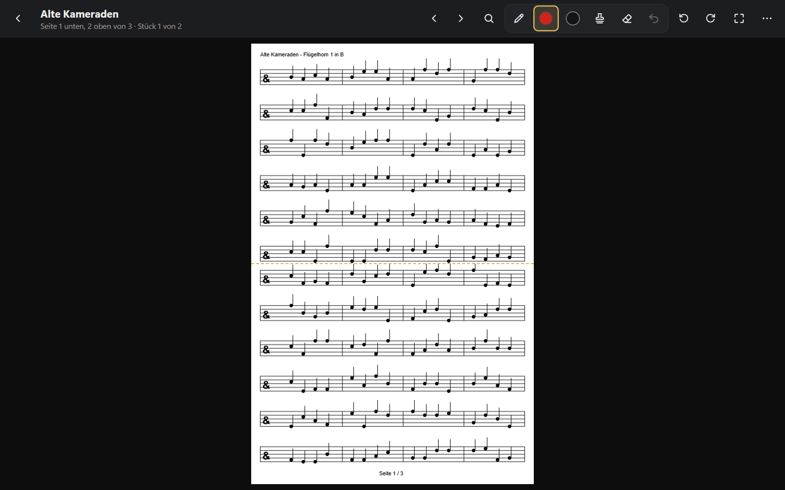

### Sprung-Links (Wiederholungen, D.S., Coda)

1. Im Notenmodus ⋯ → **„Sprung-Link setzen …“**.
2. Auf das Sprungzeichen tippen (Wiederholungszeichen, D.S., „To Coda“).
3. Zum Ziel blättern (wischen, ◀ ▶ oder Pedal) und auf die Zielstelle tippen (Segno, Coda, Anfang der Wiederholung).

An der Sprungstelle erscheint ein Knopf **„↪ S. 1“**. Antippen springt hin, die Zielstelle leuchtet kurz auf, und
unten links steht **„Zurück zu Seite …“**. Beim normalen Weiterblättern verschwindet er wieder. Mit einem Pedal:
in *Pedal & Fernbedienung* einer Taste **„Sprung-Link folgen“** zuweisen. Die Links gehören zur Stimme;
⋯ → „Sprung-Links …“ listet und löscht sie.

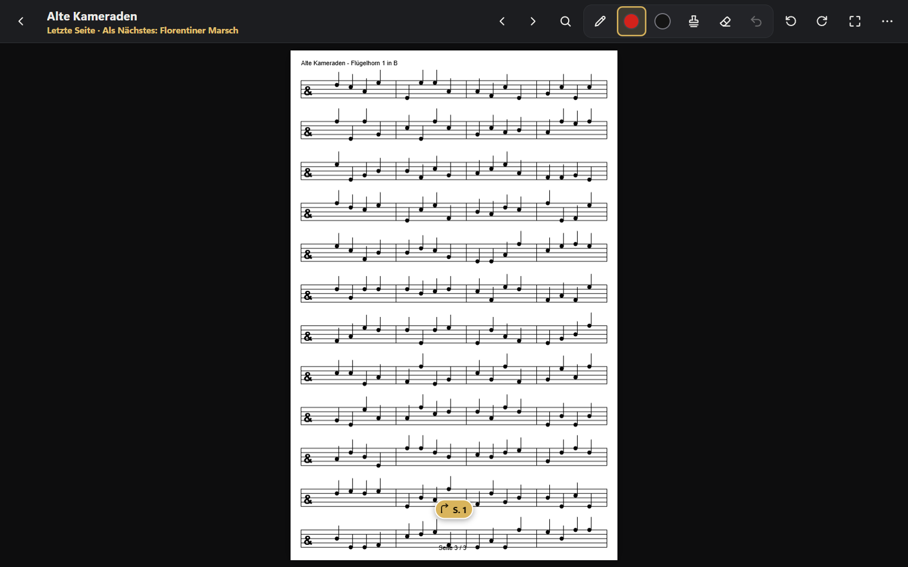

### Stempel, Text und Textmarker

Der **Stempel-Knopf** in der Leiste (neben Rot und Schwarz) öffnet Farben (Rot, Schwarz, Blau, Grün), den
**Textmarker**, **Text** und die **Stempel**. Nach der Wahl auf die Noten tippen – mit dem Stift oder, weil
der Zeichenmodus dabei angeht, mit dem Finger. Ein Stempel bleibt gewählt, bis du Rot oder Schwarz antippst;
so setzt du schnell mehrere. Radierer und Rückgängig gelten für alles.

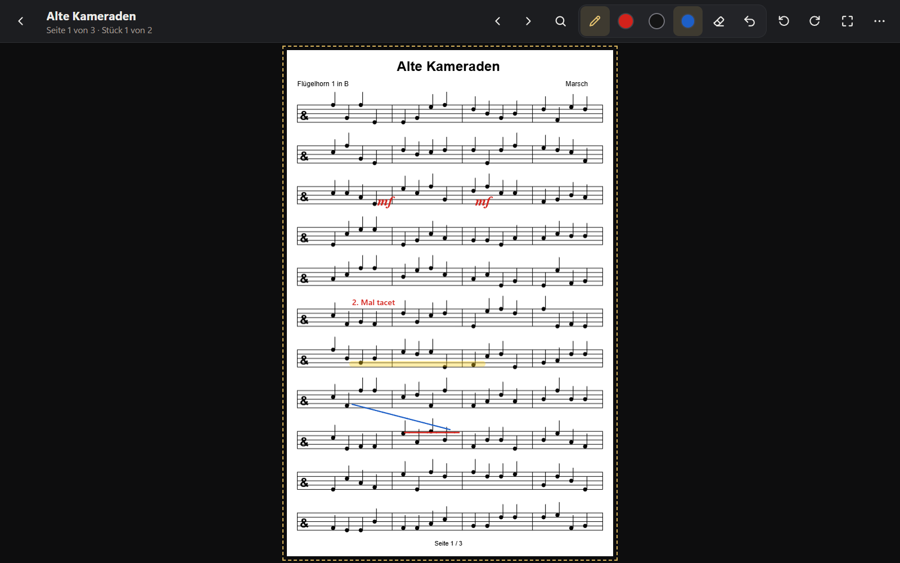

### Ansicht je Stück und Stimme

Im Notenmodus oben rechts **⋯** antippen und unter „Ansicht für dieses Stück“ wählen:

- **Automatisch**, **Immer zwei Seiten**, **Immer eine Seite**, **Seitenbreite** – wie in den Einstellungen.
- **Erste Seite einzeln, dann je zwei** – z. B. bei drei Seiten: Seite 1 allein (am Ende stehen Pausentakte zum
  Umblättern), Seiten 2 und 3 zusammen, weil dort keine Zeit zum Blättern ist.
- **Wie in den Einstellungen** – vergisst die eigene Ansicht wieder.

Die Wahl gilt nur für **dieses Stück und die gerade gezeigte Stimme** (Stimmen haben oft unterschiedlich viele
Seiten), egal ob das Gerät quer oder hochkant steht. Sie wird sofort gespeichert und kommt beim nächsten Öffnen
wieder – auch in jeder Setlist. Alle anderen Stücke zeigen die Ansicht aus *Einstellungen → Notenansicht*.

Der Schalter **„Ansicht je Stück und Stimme merken“** (*Einstellungen → Notenansicht*) gilt für dieses Gerät und
bleibt beim Übertragen von einem anderen Gerät erhalten. Ist er aus, zeigen alle Stücke die Ansicht aus den
Einstellungen – praktisch auf einem kleinen Tablet, das immer nur eine Seite zeigen soll, während der Laptop
Doppelseiten nutzt. Die gemerkten Ansichten gehen dabei nicht verloren und kommen beim Übertragen trotzdem mit.

## Fußpedal & Fernbedienung

Das Gerät zuerst in den **Bluetooth-Einstellungen** von Windows bzw. Android koppeln – es meldet sich dort meist als
Tastatur. Danach blättert es im Notenmodus ohne weitere Einstellung, wenn es eine dieser Tasten sendet:

| Weiter | Zurück |
| --- | --- |
| Bild ↓, →, ↓, Leertaste, Enter | Bild ↑, ←, ↑, Rücktaste |
| Lauter, Nächster Titel, Play/Pause, Kamera | Leiser, Voriger Titel |

- **Fußpedale** (AirTurn, PageFlip Firefly/Cicada, M-Vave/Cuvave Cube Turner, Donner, iRig BlueTurn …): Die
  meisten haben mehrere Modi, die per Knopf oder Tastenkombination wechseln. Jeder Modus mit Bild ↑/↓,
  Pfeiltasten oder Enter/Rücktaste passt. Modi mit Mausklick gehen auch (Klick = weiter, Rechtsklick = zurück).
- **Selfie-Auslöser** (z. B. „AB Shutter3“ von AliExpress/Amazon) senden „Lauter“, manche zusätzlich Enter. Ein
  Druck blättert trotzdem nur eine Seite.
- **Scroll-Ringe** („TikTok-Ring“, „Page-Turner-Ring“) wischen wie ein Finger nach oben (= weiter) oder unten
  (= zurück), drehen ein Mausrad oder senden Lauter/Leiser – alles drei blättert.
- **MIDI-Pedale** (z. B. AirTurn BT500 im MIDI-Modus) unter Windows: im Dialog „Tasten testen & zuweisen“ einmal
  treten und zuweisen. Pedale im Taster-Modus verwenden (Note an oder Controller ≥ 64 beim Treten).
- **Lautstärketasten**: Solange die Notenansicht offen ist und „Lautstärke- und Medientasten blättern“ an ist,
  blättern Lauter/Leiser statt die Lautstärke zu ändern – auch die Tasten am Tablet selbst. Außerhalb der
  Notenansicht ändern sie wie gewohnt die Lautstärke.

**Eigene Belegung:** *Einstellungen → Pedal & Fernbedienung → „Tasten testen & zuweisen“*. Eine Taste am Gerät
drücken: Notenpult zeigt, was ankommt (z. B. „Erkannt: „Bild ↓“ – Weiter“). Mit „Taste zuweisen“ bekommt eine Taste
eine Aktion: **Weiter, Zurück, Nächstes Stück, Voriges Stück, Nächste Stimme**. ✕ entfernt eine Taste,
„Standard wiederherstellen“ setzt alles zurück.

Belegung und Schalter (Lautstärketasten, Mausrad, nach oben/unten wischen) gelten **nur für das jeweilige Gerät**
und bleiben beim Übertragen von einem anderen Gerät erhalten – das Pedal am Tablet und der Ring am Laptop
stören sich nicht.

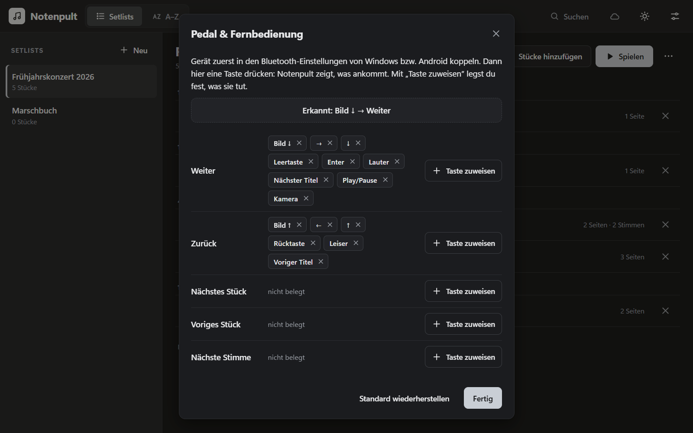

## Blättern per Gesicht

*Einstellungen → Blättern per Gesicht*. Im Notenmodus beobachtet die Kamera vorne dein Gesicht und blättert bei
einer Geste:

- **Kopf drehen** – rechts = weiter, links = zurück,
- **Mund öffnen** – weiter,
- **Zwinkern** – rechtes Auge = weiter, linkes = zurück (normales Blinzeln mit beiden Augen zählt nicht).

Eine Geste muss kurz gehalten werden und danach wieder in die Ausgangshaltung zurück – ein Blick zur Seite blättert
nicht. **Empfindlichkeit** stellt ein, wie deutlich die Bewegung sein muss; **„Richtung tauschen“** dreht weiter und
zurück um. **„Testen …“** zeigt das Kamerabild und die erkannten Werte. Im Notenmodus steht unten rechts
„Gesicht“ – antippen pausiert.

Die Erkennung (MediaPipe von Google) läuft vollständig auf dem Gerät; es wird kein Bild gespeichert oder gesendet.
Die Kamera ist nur an, solange die Notenansicht offen ist. Beim ersten Mal fragen Windows bzw. Android nach dem
Kamerazugriff. Gilt nur für dieses Gerät.

## Stimmgerät

Die **Stimmgabel** oben (oder ⋯ → „Stimmgerät“ im Notenmodus) öffnet das Stimmgerät: Ton spielen – es zeigt den
Ton (deutsche Namen: B = B♭, H = B), die Oktave, die Abweichung in Cent auf der Nadel und die Frequenz. Nadel und
Ton in der Akzentfarbe und „Stimmt.“ heißt: auf ± 5 Cent genau; eine rote Nadel zeigt, ob du zu tief oder zu hoch
bist.

- **Kammerton a¹**: − / + oder 440, 441, 442, 443 Hz – wird gespeichert.
- **Anzeige für**: C (klingend), B, Es oder F – dann steht da der Ton, wie er in deinen Noten steht (B-Trompete:
  klingend B = notiert C).

Beim ersten Mal fragen Windows bzw. Android nach dem Mikrofon. Das Stimmgerät ist neu – Rückmeldungen willkommen.

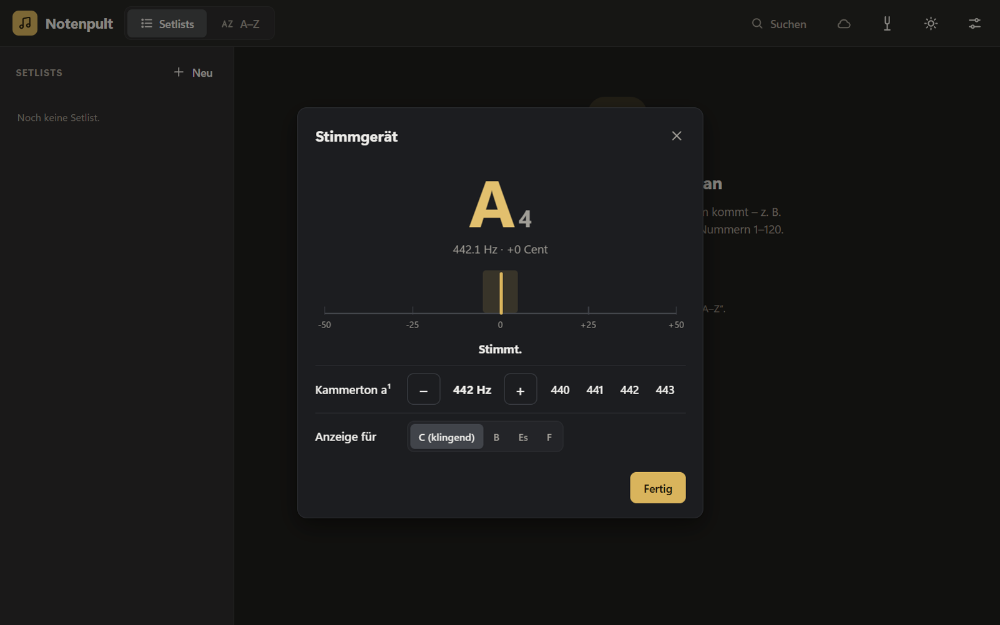

### Stimmgerät auf dem Blatt

Im Notenmodus sitzt in der Stift-Leiste (neben Farben, Radierer, Rückgängig) eine **Stimmgabel**. Ein Klick schaltet
das kleine Stimmgerät an, ein zweiter wieder aus. Es erscheint immer **oben links** und zeigt nur die Abweichung –
**„+12¢“** zu hoch, **„−8¢“** zu tief, „±0¢“ genau – in Rot, ohne Rahmen, direkt über den Noten. Ohne Ton steht
blass „—¢“.

- **Verschieben**: anfassen und ziehen. Antippen blättert nicht um.
- **Größe**: an der kleinen Ecke unten rechts ziehen, mit zwei Fingern auseinander/zusammen oder mit dem Mausrad.
  Die Größe merkt sich jedes Gerät.
- **Kammerton** kommt aus dem Stimmgerät (z. B. 442 Hz).

Es bleibt für die nächsten Stücke an, bis du es ausschaltest; das Mikrofon läuft nur, solange die Noten offen sind.

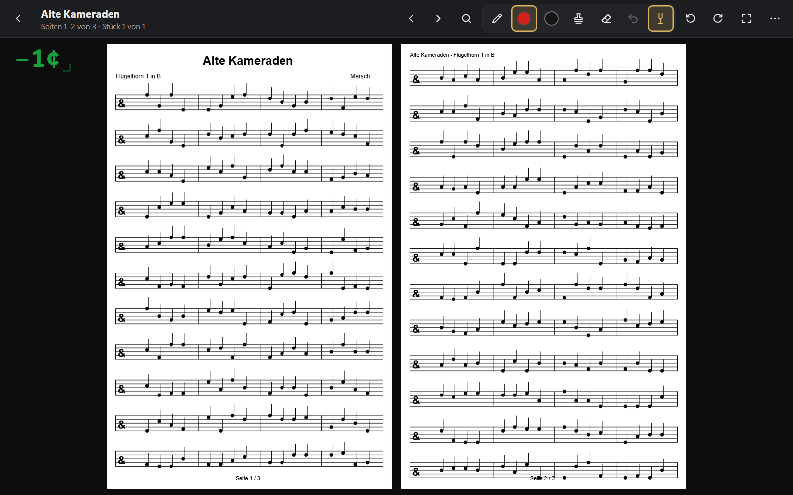

## Google Drive (Noten-Pool)

Voraussetzung ist [Google Drive für Desktop](https://www.google.com/drive/download/) (Laufwerk mit „Meine Ablage“).
Über den Wolken-Knopf oben einen Drive-Ordner wählen:

- **Nur meine Stimme**: Filter wie `Flügelhorn 1` (mehrere mit Komma).
- **Aufbau**: „Jede Datei = ein Stück“ oder „Unterordner = Stück“
  (`Rosen aus dem Süden/Flügelhorn 1.pdf`, `…/Flügelhorn 2.pdf` → ein Stück mit zwei Stimmen).
- **Übernehmen**: „Alles automatisch“ (Abgleich beim Start, alle 10 Minuten und wenn die Verbindung
  zurückkommt) oder „Nur bei Bedarf“ (einzelne Stücke über die Suche laden).

Geladene Noten sind Kopien in Notenpult. In Drive gelöschte Dateien bleiben erhalten, geänderte werden
übernommen (Anmerkungen bleiben).

## Daten & Sicherung

Alles liegt in `Dokumente\Notenpult`:

| Datei/Ordner | Inhalt |
| --- | --- |
| `notenpult.json` | Stücke, Stimmen, Setlists, Einstellungen |
| `notenpult.backup.json` | Stand vom letzten Start |
| `Noten\` | importierte PDFs/Bilder (Kopien – Originale bleiben unberührt) |
| `Anmerkungen\` | Stiftstriche je Stück |
| `pool-index.json` | zuletzt gelesener Inhalt des Noten-Pools (Suche offline) |
| `_vor-import\` | Stand vor dem letzten „Alles importieren“ |
| `_vor-abgleich\` | Stand vor dem letzten „Aus dem WLAN holen“ |

### Alles übertragen (z. B. PC → Tablet) oder sichern

*Einstellungen → Daten → „Exportieren …“* erstellt **eine ZIP-Datei** mit allen Stücken (PDFs/Bilder), Stimmen,
Setlists, Genres, Anmerkungen und Einstellungen. Auf dem anderen Gerät *„Importieren …“* wählen und die ZIP
öffnen: Danach ist dort alles **spiegelgleich** (außer der Seitenansicht des Geräts) – vorher Vorhandenes wird
ersetzt (unter Windows bleibt es in
`_vor-import` erhalten). Das funktioniert in beide Richtungen, also auch, um Anmerkungen vom Tablet zurück auf
den PC zu holen.

## Entwicklung

Voraussetzungen: Windows, [Node.js](https://nodejs.org/) 22.12 oder neuer.

```bash
npm install
```

```bash
npm start
```

```bash
npm test
```

```bash
npm run package
```

- `npm install` lädt auch die Electron-Laufzeit und kopiert pdf.js nach `renderer/vendor/`.
- `npm test` startet die App unsichtbar mit Beispielnoten und prüft Blättern, Stift, Stimmen, A4/A5,
  Drehen, Noten-Pool, Suche usw. (Screenshots landen in `test/out/`).
- `npm run package` baut `dist/Notenpult-win32-x64/Notenpult.exe`.
- Android: `npm run android:web` bündelt die Oberfläche nach `android/app/src/main/assets/www`, danach baut
  `gradle -p android assembleDebug` (Android SDK, JDK 17, Gradle 8.11) die APK. Die CI macht beides.

Aufbau des Codes: [docs/ARCHITEKTUR.md](docs/ARCHITEKTUR.md) · Arbeitsweise mit Branches und Pull Requests:
[CONTRIBUTING.md](CONTRIBUTING.md) · Änderungen: [CHANGELOG.md](CHANGELOG.md)

## Technik

[Electron](https://www.electronjs.org/) und [pdf.js](https://mozilla.github.io/pdf.js/) (Apache-2.0) mit
reinem JavaScript (ES-Module) und CSS, ohne Framework und ohne Build-Schritt für die Oberfläche.
Die Android-App ist eine schlanke Java-Activity mit WebView; dieselbe Oberfläche wird dafür mit
[esbuild](https://esbuild.github.io/) für Chrome 92–95 gebündelt und nutzt pdf.js 3.11.
